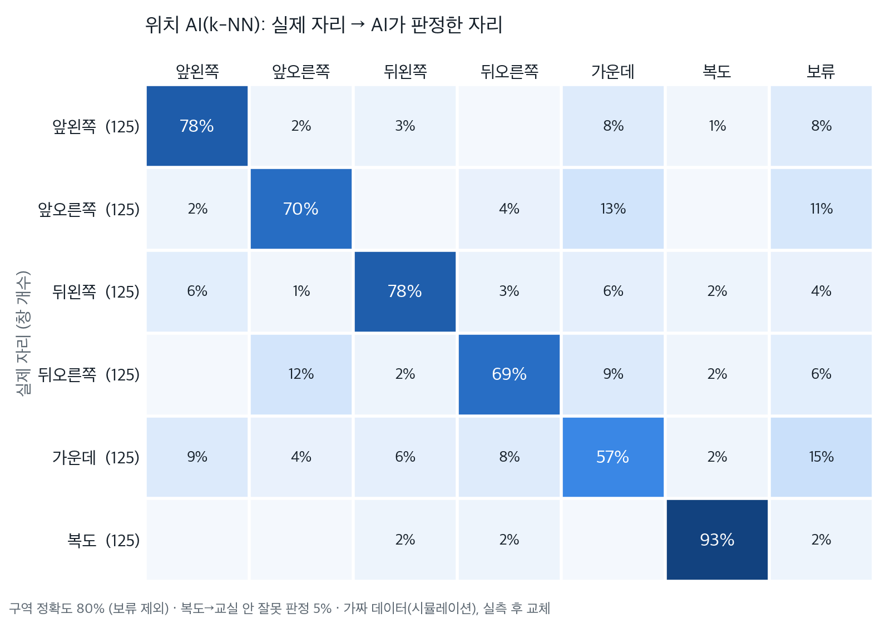
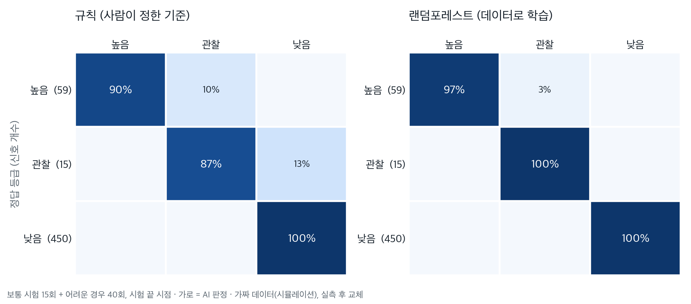

# 규칙 vs 랜덤포레스트 비교표

> ⚠️ 가짜 데이터(시뮬레이션) 결과. 코드가 맞게 도는지 확인용이며 판넬에는 실측으로 바꿔 넣는다.
> 만든 명령: `python3 experiments/compare.py` · RF 중요 특징: inside_min 0.30, seen_ratio 0.27, inside_ratio 0.22, zone_changes 0.13, pkt_per_sec 0.07  (학습 예 734개 {'낮음': 587, '높음': 98, '관찰': 49})

## 한눈에

| 지표 | 목표 | 규칙 | RF |
|---|---|---|---|
| 숨긴 기기 → 높음 | 90% 이상 | 53/59 | 57/59 |
| 숨긴 기기 → 관찰 이상 (놓치지 않음) | 100% | 59/59 | 59/59 |
| 잘못된 경보 (낮음인데 높음) | 0회 | 0회 | 0회 |
| 낮음인데 관찰 (가벼운 헛걸음) | 적을수록 | 0회 | 0회 |

## 경우별

| 경우 | 규칙: 높음 / 관찰 이상 / 잘못된 경보 | RF: 높음 / 관찰 이상 / 잘못된 경보 |
|---|---|---|
| 보통 시험 (카메라·이어폰·AI 안경 중 1개) | 15/19 / 19/19 / 0회 | 17/19 / 19/19 / 0회 |
| 뒷벽 바로 앞 자리에 숨긴 BLE 이어폰 (복도와 헷갈림) | 8/10 / 10/10 / 0회 | 10/10 / 10/10 / 0회 |
| 한가운데 자리에 숨긴 Wi-Fi 카메라 (네 센서 거리가 비슷) | 10/10 / 10/10 / 0회 | 10/10 / 10/10 / 0회 |
| 숨긴 기기 2개 동시 (이어폰 + 카메라, 다른 자리) | 20/20 / 20/20 / 0회 | 20/20 / 20/20 / 0회 |
| 벽 바로 밖 복도에 시험 내내 서 있는 사람 (높음이 뜨면 안 됨) | (숨긴 기기 없음) 낮음 유지 88/88 / 0회 | (숨긴 기기 없음) 낮음 유지 88/88 / 0회 |

- '벽 근처' 조건(교실 안 비율 25~50% + 15분 이상)에 걸린 신호: 2개. 규칙은 이것을 '관찰 (벽 근처)'로 판정하고, RF가 '낮음'이라 해도 '관찰'로 올린다.
- 숨긴 기기 개수가 시험 횟수보다 많은 이유: AI 안경은 MAC이 바뀌어 이어 붙지 못한 조각을 각각 센다. 짧은 조각은 15분이 안 돼 '관찰'로 남는다.

## 판넬용 한 줄

- 규칙은 **왜 그렇게 판정했는지 설명하기 쉽고**, 랜덤포레스트는 **여러 특징을 함께 보고 기준을 데이터로 정한다**.
- 둘 다 '높음'은 확실할 때만 (잘못된 경보 0회 목표). 애매한 경우는 '관찰'로 남겨 쉬는 시간에 확인.

